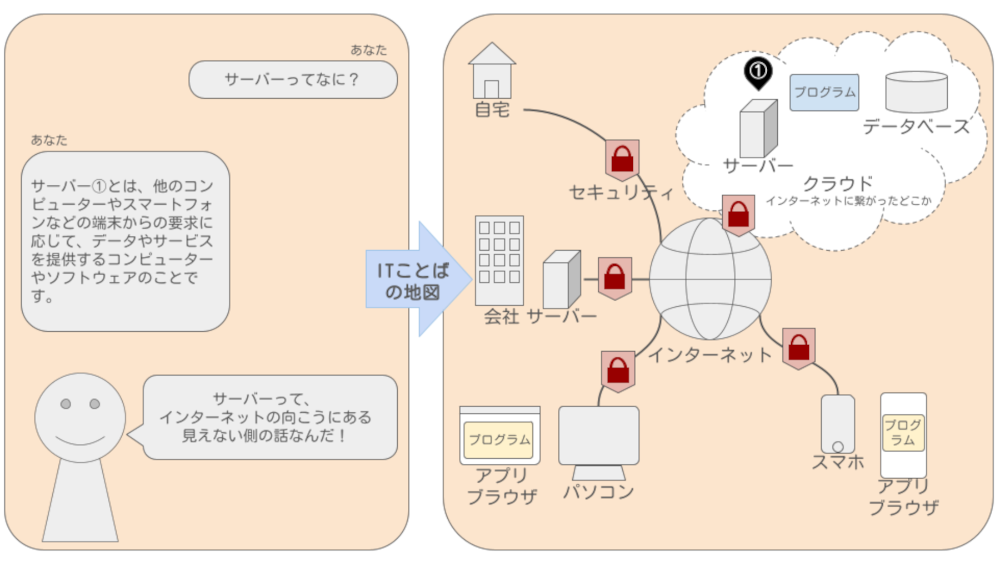

SNS
インターネット/Web/ネット
アプリ/アプリケーション
クラウド
データベース
プログラム
ストレージ
ファイル
ファイルストレージ
個人情報
認証
認可
不正アクセス
セキュリティ
PHP　　　由来：PHP Hypertext Preprocessorの頭文字であり、名称の中に略称が含まれる再帰的頭字語という構造の名前をしています。
プログラミング言語
脆弱性
ハードウェア
ソフトウェア
システム
